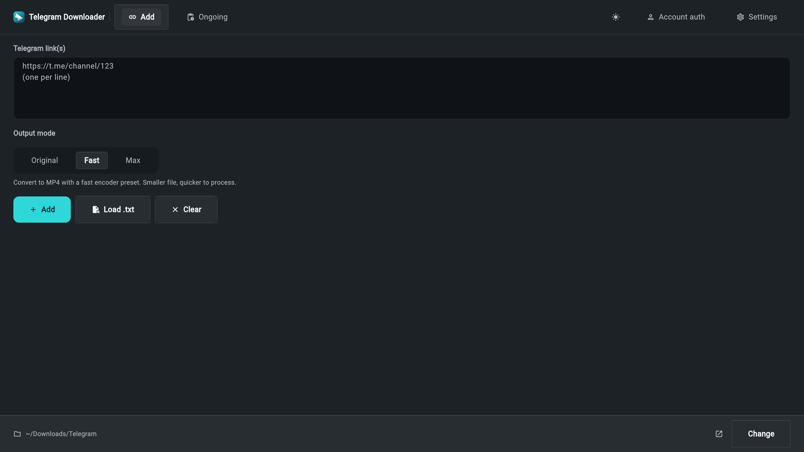
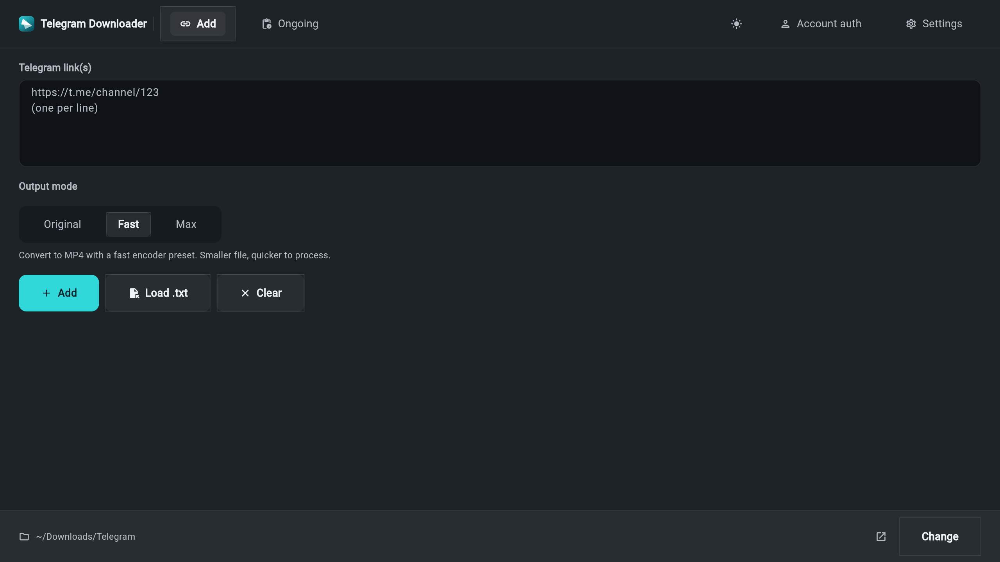
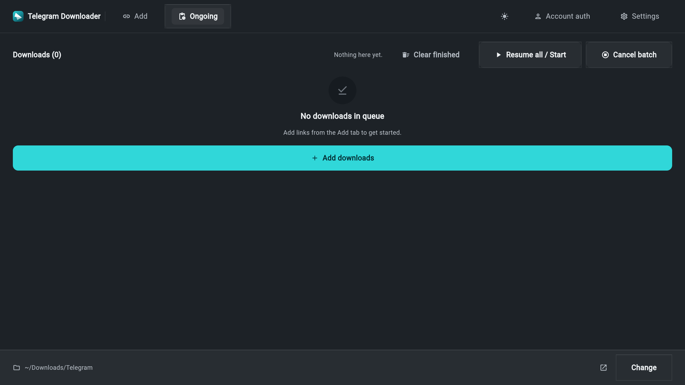
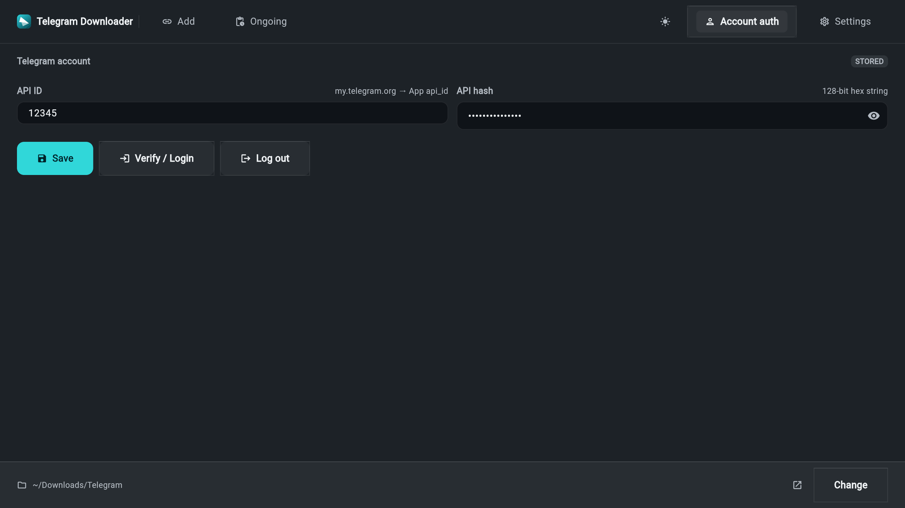
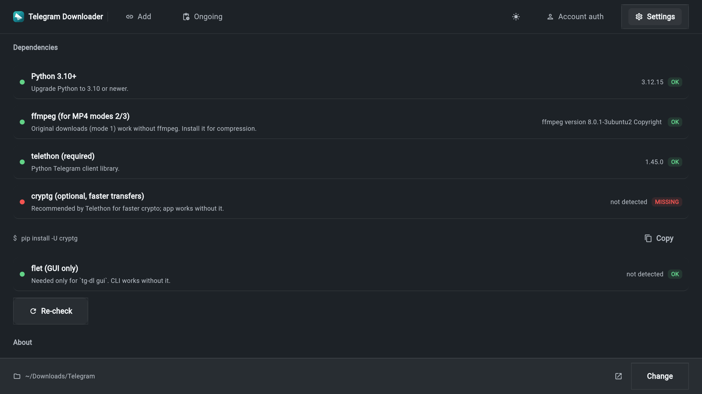

# Telegram Downloader

<p align="center">
  
</p>

<p align="center">
  Download media from Telegram with a desktop GUI or a CLI — persistent login, resumable downloads, batch queue, and MP4 conversion.
</p>

<p align="center">
  <a href="https://github.com/MDHasan0078/telegram-downloader/releases"></a>
  <a href="https://github.com/MDHasan0078/telegram-downloader/actions"></a>
  
  
</p>

<p align="center">
  
</p>

One window, four destinations. **Add** the links, **Ongoing** to watch them land,
**Account auth** for your API credentials and the Telegram login, **Settings** for
dependencies, updates and the danger zone. The download folder lives in the bar along
the bottom of the window, so it can be changed from anywhere. The same engine runs
headless from the CLI.

## What it does

- **Single or batch links** — paste one or many `t.me` URLs, or load a `.txt` batch file.
- **A queue that survives a restart** — progress lives in `queue.json`, and an interrupted
  download resumes from its partial file.
- **Persistent login** — sign in once; the session is reused on every later run.
- **MP4 conversion** — Original (no re-encode) · Fast · Max via ffmpeg, chosen per download
  on the Add tab.
- **A dependency checker** — what is installed and the exact install command for your OS.
- **In-app updates** — *Check for updates* in Settings, with Later / Open page / Download.
- **Dark theme** — dark by default, switchable from the toggle in the top bar.
- **Preview before download (CLI only)** — `tg-dl preview` lists titles and sizes, and
  `tg-dl download` asks before it starts. The GUI goes straight to the queue.

## Quick start

```bash
git clone https://github.com/MDHasan0078/telegram-downloader
cd telegram-downloader
./scripts/install-deps.sh --gui --speed   # python, ffmpeg, pip package
tg-dl gui                                # launch the desktop GUI
```

Already have a release? `sudo apt install ./telegram-downloader_<version>_amd64.deb`,
then `tg-dl gui`.

The first launch asks for your **API ID + API hash** — get them at
[my.telegram.org](https://my.telegram.org) → API development tools — and for your
Telegram login. Downloads land in `~/Downloads/Telegram`; change the folder from the bar
along the bottom of the window. Credentials are stored privately with `0600` permissions.

## Install

Each release ships a Linux `.deb`. Download the latest from the
[**Releases**](https://github.com/MDHasan0078/telegram-downloader/releases)
page and install it:

```bash
sudo apt install ./telegram-downloader_<version>_amd64.deb
```

A release may also carry an `.apk` when the Android build succeeds — download
it on an Android device, allow installs from your file manager, and open it.
There is no macOS installer; on macOS, run from source:

```bash
git clone https://github.com/MDHasan0078/telegram-downloader
cd telegram-downloader
./scripts/install-deps.sh --gui --speed   # python, ffmpeg, pip package
tg-dl deps                                # verify everything is installed
tg-dl gui                                 # launch the desktop GUI
```

| Platform | Notes |
|---|---|
| Debian / Ubuntu | Install the release `.deb` as shown above, or `./scripts/build-deb.sh` → `dist/*.deb` |
| Other Linux | `./scripts/install-deps.sh --gui --speed`, then `pip install -e ".[gui]"` |
| macOS | From source only: `brew install python ffmpeg`, then the same pip steps |
| Android / Termux | `pkg install python ffmpeg`, then `pip install -e ".[gui]"` |

## The GUI

Dark-first Material 3, with one accent colour that means *action* and nothing else.
The top bar is the navigation — the brand, the two primary destinations, the theme
toggle, then the two settings-side destinations. The bottom bar is the download folder.

### Add

<p align="center">
  
</p>

Paste one or many `t.me` links (or load a `.txt` file), pick the **output mode**, and
press Add — the links go straight into the queue, no preview step. A `.txt` batch file
is capped at 256 KB.

### Ongoing

<p align="center">
  
</p>

Live progress with speed and ETA, retry or remove per item, Resume all / Start, cancel
the batch. Partial files are kept, so an interrupted download resumes where it stopped.

### Account auth

<p align="center">
  
</p>

Your API ID and hash, and the Telegram login itself — sign in, sign out. This is where
the credentials live; they are stored with `0600` permissions and never leave the machine.

### Settings

<p align="center">
  
</p>

**Dependencies** (what is installed, and the exact command to fix it), **About** (version,
engine, ffmpeg, and a *Check for updates* button), and the **danger zone** (sign out,
delete the saved credentials, empty the queue).

Supported links:

```text
https://t.me/channel/123
https://t.me/channel/244/264        # thread / topic
https://t.me/c/1234567890/123
https://t.me/c/1234567890/244/264
```

## Configuration

Everything the app needs is in one place, and the app tells you where:

| What | Where it lives |
|---|---|
| API ID + API hash | **Account auth** tab, or `tg-dl config` |
| Telegram login | **Account auth** → Verify / Login, or `tg-dl config login` |
| Download folder | the bar along the **bottom** of the window, or `tg-dl config set download_dir=…` |
| Output mode (Original / Fast / Max) | the **Add** tab, next to the links it applies to, or `tg-dl config set output_mode=2` |
| Theme | the toggle in the **top bar** |
| The queue | `queue.json` in the config directory — it survives a restart |

The config directory is `~/.config/telegram-downloader/` (mode `0700`); the config file
and the Telegram session are `0600`. `tg-dl config show` prints the current settings,
`tg-dl config path` prints the directory, and `tg-dl config reset` puts everything back.

## CLI

```bash
tg-dl gui                                   # launch GUI
tg-dl --version                             # installed version
tg-dl update                                # check GitHub releases
tg-dl preview <URL>...                      # fetch titles only (max 100 URLs)
tg-dl download <URL>...                     # fetch → confirm → download
tg-dl download -y --mode 2 --dir ~/Videos <URL>...
tg-dl batch urls.txt -y                     # one URL per line, file max 256 KB
tg-dl config show | set | path | login | logout | reset
tg-dl config set download_dir=/mnt/drive output_mode=2
tg-dl deps                                  # dependency check
python -m telegram_downloader gui           # same as: tg-dl gui
```

## Project layout

```text
src/telegram_downloader/
  config.py          settings (~/.config/telegram-downloader/config.json, 0600)
  telegram_utils.py  URL parsing, filenames, titles (unit-tested)
  tg_client.py       Telethon client, preview, login
  downloader.py      resumable chunk downloader with progress callback
  converter.py       ffmpeg / ffprobe wrapper
  deps.py            per-OS dependency checker
  updates.py         GitHub-release update checker (stdlib only)
  queue_store.py     queue.json persistence (0600)
  cli.py             tg-dl command
  gui.py             Flet GUI (top tabs: Add / Ongoing / Account auth / Settings)
tests/               pytest, no network required
scripts/             install-deps.sh, build-deb.sh, build-apk.sh
docs/                the screenshots used by this README
```

## Releases

Pushing a `v*` tag runs [CI](.github/workflows/build.yml): tests, then the
`.deb` build, plus an `.apk` build. The `.deb` is what every release ships and
what the in-app updater installs; a failed `.apk` build does not block the
release, so some releases carry the `.deb` alone. Artifacts are attached to the
[GitHub Release](https://github.com/MDHasan0078/telegram-downloader/releases):

```bash
git tag v0.2.0 && git push origin v0.2.0
```

Version source of truth: `__version__` in `src/telegram_downloader/__init__.py` **and**
the `version =` line in `pyproject.toml` must declare the *same* version — bump both in
the same commit. A test asserts they agree, because a checkout installed from a stale
`pyproject.toml` reports the wrong version and the updater then nags about a release
you are already running. CI stamps both files from the release tag.

## Troubleshooting

| Symptom | Fix |
|---|---|
| `externally-managed-environment` | Use a venv (`python3 -m venv .venv`) or run `scripts/install-deps.sh` |
| Phone invalid | Use full international format, e.g. `+8801XXXXXXXXX` (typed blind — input is hidden, type carefully) |
| Login every run | Finish one login; check `~/.config/telegram-downloader/session.session` exists; `tg-dl config logout` then log in again |
| Transfer timeout / resume | Keep the partial file; rerun or Ongoing → Resume all / Start (backoff + reconnect built in) |
| ffmpeg missing | Mode 1 works without it; check Settings > Dependencies for the exact install command, or run `scripts/install-deps.sh` |
| Private channel / not found | The same account must be able to open the link in Telegram; check thread vs message id order |
| GUI won't start | `pip install -e ".[gui]"`, then `tg-dl gui`; see `tg-dl deps` |

## Security

- `api_hash` + `session.session` = full account access. Never commit
  `~/.config/telegram-downloader/`, never share it.
- Permissions are locked down automatically: config dir `0700`;
  `config.json` / `session*` / `queue.json` at `0600` (re-hardened on login/save).
- Secrets are masked in `tg-dl config show`, the GUI hash field, and all error messages;
  these paths are git-ignored so they can't be committed by accident.
- If you expose the GUI over the network (port forward / tunnel), anyone with the URL
  can use your saved login — treat the link like a password and close the tunnel after.
- Download only media you're authorized to save; follow the Telegram ToS and local law.

## Development

```bash
pip install -e ".[test]" && python -m pytest -q
tg-dl deps && tg-dl config show
```
